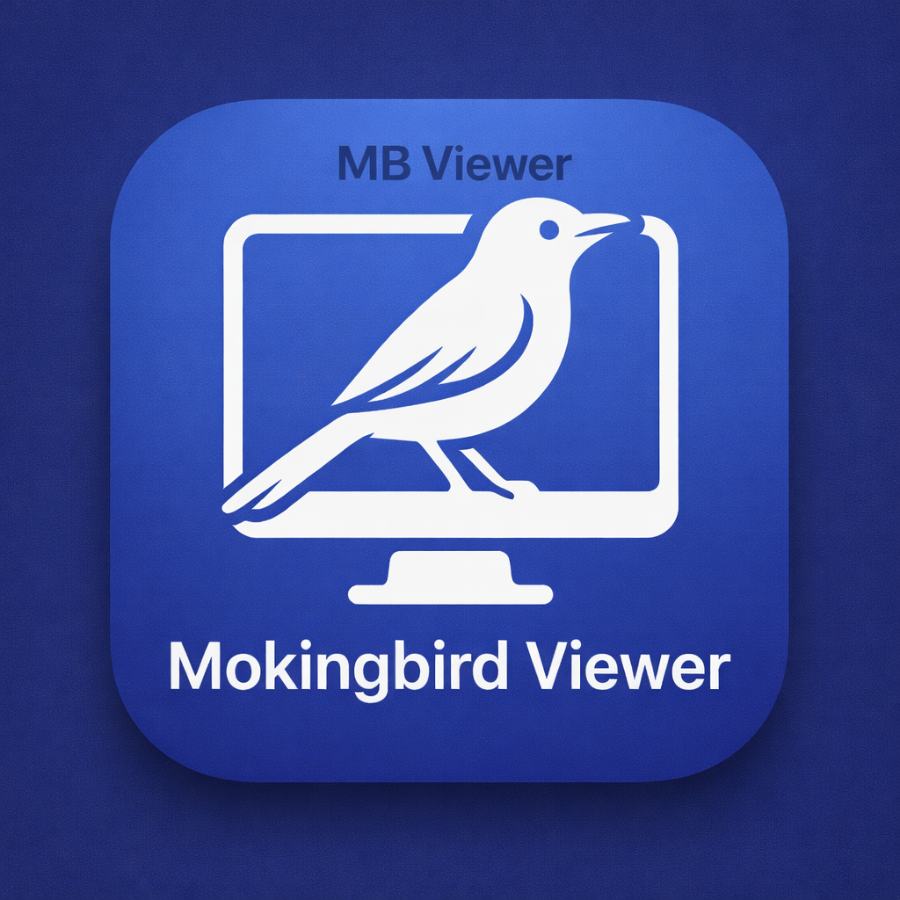
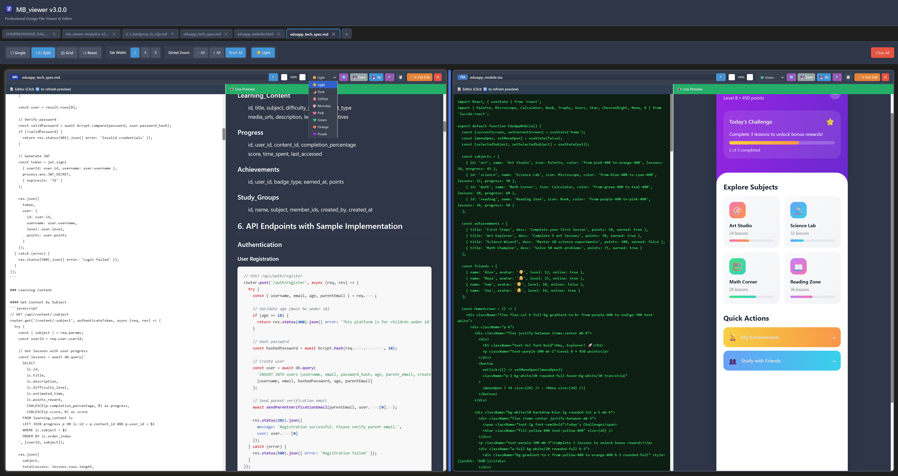
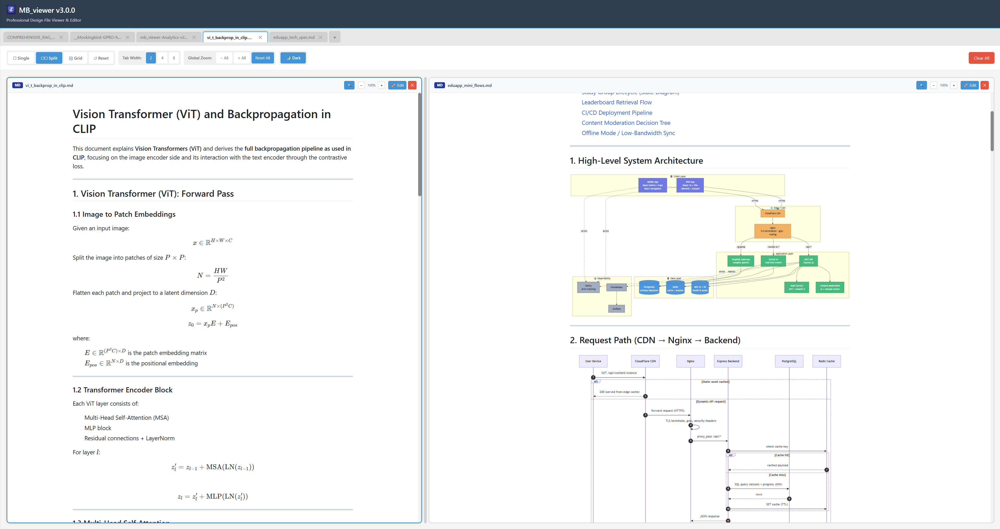
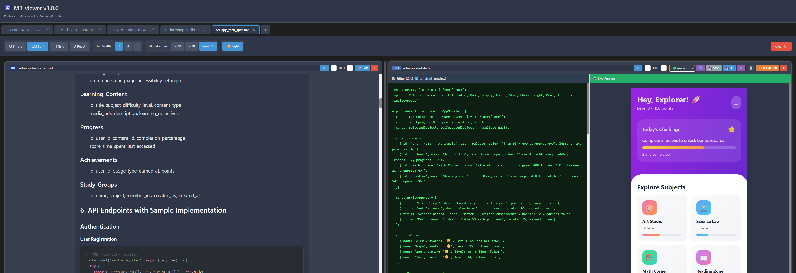
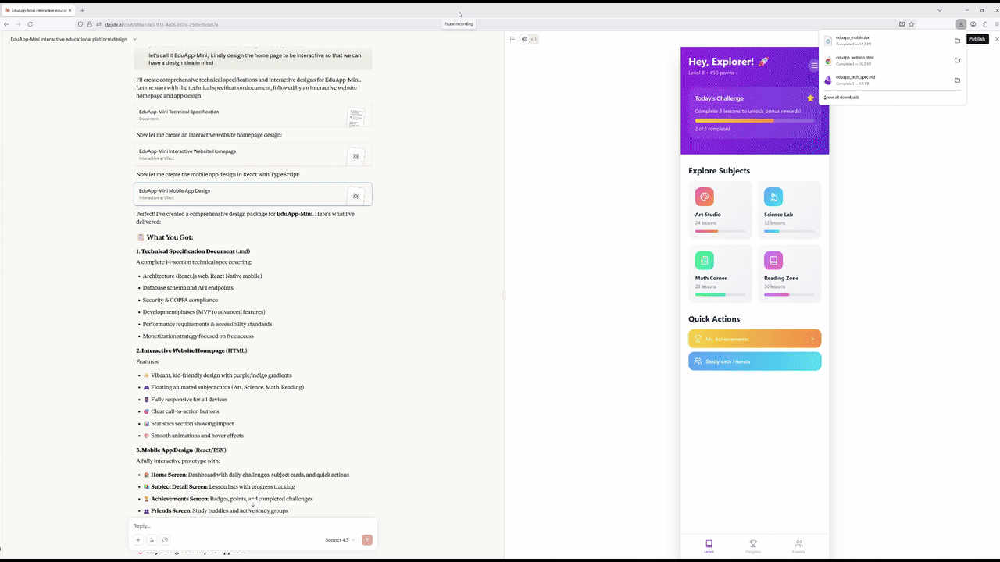
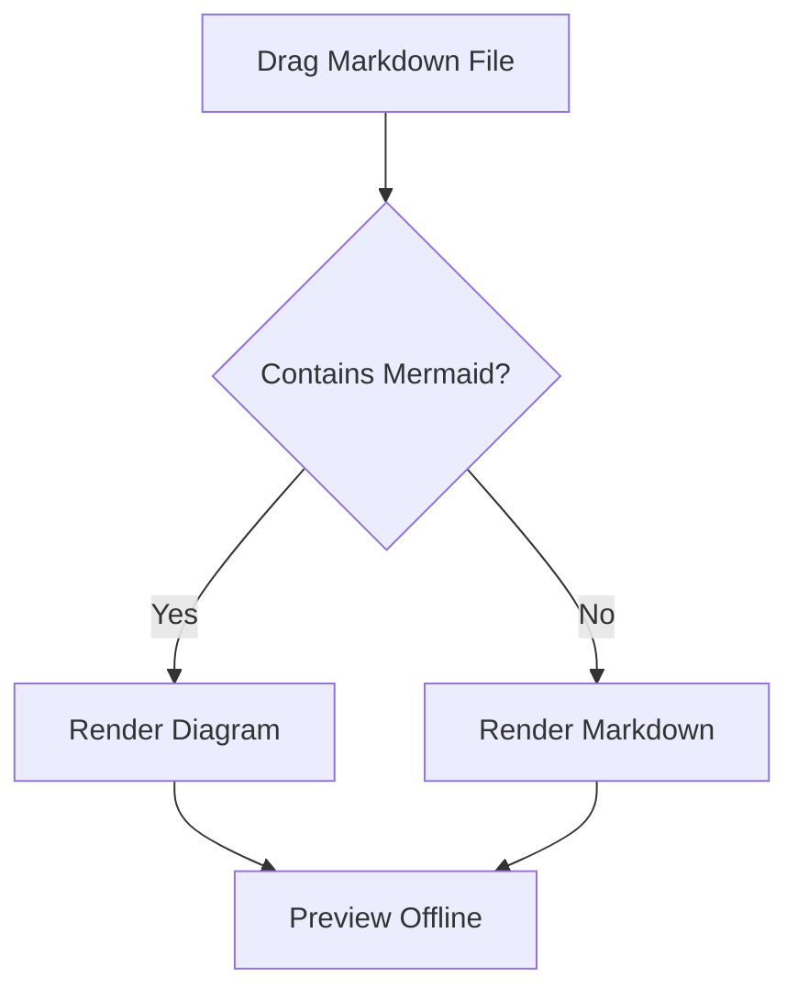

# 🚀 MB_viewer v3.0.0

<div align="center">



**The offline desktop viewer for TSX, JSX, HTML, Markdown, diagrams, math, and design-file previews.**

[](https://github.com/mokingbird-xyz/mb-viewer-downloads/releases)
[](https://github.com/mokingbird-xyz/mb-viewer-downloads/releases)
[](#-download)
[](#-perfect-for)
[](#-offline-private-and-zero-setup)

[🎯 What's New](#-whats-new-between-250-and-300) . [✨ Features](#-complete-feature-overview) . [📥 Download](#-download) . [🚀 Quick Start](#-quick-start) . [📝 Changelog](#-release-highlights) . [🗺️ Roadmap](#-roadmap)

## 🌐 Read More & Download

For the full product page, screenshots, download guidance, and latest public release links, visit:

**👉 [mbviewer.mokingbird.xyz](https://mbviewer.mokingbird.xyz/)**

You can also download directly from mbviewer website:
**📦 [mbviewer.mokingbird.xyz/download](https://mbviewer.mokingbird.xyz/download)**

Questions, feedback, feature requests, or download issues:

**💬 [support@mbviewer.mokingbird.xyz](mailto:support@mbviewer.mokingbird.xyz)**


### 🎉 Download Version **3.0.0** here:

| Platform | Download Link | Size |
|----------|--------------|------|
| 🪟 **Windows** | [Download MB_Viewer-3.0.0.exe](https://github.com/mokingbird-xyz/mb-viewer-downloads/releases/download/v3.0.0/MB_Viewer-3.0.0.exe) | ~90 MB |
| 🍎 **macOS (Intel)** | [Download MB_Viewer-3.0.0-x64.dmg](https://github.com/mokingbird-xyz/mb-viewer-downloads/releases/download/v3.0.0/MB_Viewer-3.0.0-x64.dmg) | ~112 MB |
| 🍎 **macOS (Apple Silicon)** | [Download MB_Viewer-3.0.0-arm64.dmg](https://github.com/mokingbird-xyz/mb-viewer-downloads/releases/download/v3.0.0/MB_Viewer-3.0.0-arm64.dmg) | ~113 MB |
| 🐧 **Linux** | [Download MB_Viewer-3.0.0.AppImage](https://github.com/mokingbird-xyz/mb-viewer-downloads/releases/download/v3.0.0/MB_Viewer-3.0.0.AppImage) | ~120 MB |

[View all releases](https://github.com/mokingbird-xyz/mb-viewer-downloads/releases) • [Read full changelog](docs/ReleaseNotes/)

</div>

---

## 🎯 What Is MB_viewer?

MB_viewer is a **free offline desktop application** for instantly previewing, editing, and comparing design files without setting up a development environment.

It began as a fast way to open `.tsx` and `.jsx` files generated by tools like Claude, ChatGPT, Gemini, and other AI coding assistants. Instead of creating a Vite project, installing dependencies, copying code into CodePen, or starting a local dev server, you can simply drag a file into MB_viewer and see it rendered immediately.

Since v2.5.0, MB_viewer has grown into a much broader offline workspace for modern AI-assisted file viewing:

- ⚛️ **TSX / JSX component preview** — instantly render React components without npm, Vite, or project setup
- 🌐 **HTML page preview** — open static pages, mockups, exports, and prototypes in a sandboxed viewer
- 📝 **Professional Markdown reading and editing** — preview docs with tables, code blocks, links, lists, and clean typography
- 📐 **KaTeX math rendering** — display LaTeX-style equations beautifully inside Markdown files
- 🎨 **Mermaid diagram rendering** — view flowcharts, sequence diagrams, ER diagrams, Gantt charts, timelines, mindmaps, and more
- 📊 **Multi-file comparison** — use single, split, or quad view to compare up to four files side by side
- 📑 **Multi-tab workspaces** — keep multiple independent workspaces open in one window
- 🪟 **Multi-window workflows** — drag tabs out into new windows and move tabs between windows
- 🔍 **Advanced search and zoom** — search inside files, highlight matches, and zoom each panel independently
- ✏️ **Live editing with save support** — edit files, preview changes, and save your work directly
- 🌙 **Complete dark mode and themes** — use a 3-layer theme system for the app, code blocks, and editor

MB_viewer has now passed **3500+ downloads**, with strong feedback from developers, designers, technical writers, students, researchers, and AI-assisted builders. Version **3.0.0** is the biggest public step forward so far: from a focused TSX preview tool into a full offline workspace for components, documents, diagrams, math, and multi-file review.

---

## 🎯 What's New Between 2.5.0 and 3.0.0 (All features)

From v2.5.0 to v3.0.0, MB_viewer evolved from a focused TSX/JSX preview tool into a full offline design-file workspace.

The original v2.5.0 branch already supported instant preview, live editing, advanced search, per-panel zoom, multi-slot selection, and up to four files side by side. The releases after that added professional markdown rendering, offline math, a complete dark mode, Windows file association, tabs, multi-window workflows, cross-window tab dragging, and finally Mermaid diagrams in v3.0.0.

### 🌟 Major Additions Since v2.5.0

#### 🎨 Mermaid Diagrams in Markdown and `.mmd`

MB_viewer v3.0.0 can render Mermaid diagrams directly inside Markdown files and as standalone `.mmd` / `.mermaid` files.

- Flowcharts
- Sequence diagrams
- Class diagrams
- State diagrams
- ER diagrams
- Gantt charts
- Pie charts
- Git graphs
- Mindmaps
- Timelines
- C4-style context diagrams
- XY charts

Everything runs offline. Mermaid is bundled locally, so there is no CDN dependency and no internet requirement.

#### 📐 KaTeX Math Rendering

Markdown files can now include beautiful math equations rendered with KaTeX.

- Inline math: `$E = mc^2$`
- Display math: `$$\frac{-b \pm \sqrt{b^2 - 4ac}}{2a}$$`
- LaTeX-style delimiters: `\(...\)` and `\[...\]`
- ChatGPT-style copied equations with smart detection
- Offline rendering with local KaTeX assets

This makes MB_viewer useful for research notes, technical documentation, model explanations, engineering writeups, academic content, and data-science reports.

#### 📝 Professional Markdown Reader

Markdown support is now one of MB_viewer's strongest features.

- GitHub-style formatting
- Tables, blockquotes, lists, headings, and links
- Syntax highlighted code blocks
- 20+ programming languages
- KaTeX math
- Mermaid diagrams
- Edit mode with live preview
- Search in preview and edit mode

The goal is simple: markdown should look clean, readable, and presentation-ready without leaving your desktop.

#### 🎨 Three-Layer Theme System

MB_viewer now has independent theme layers:

| Layer | Controls | Options |
|-------|----------|---------|
| App Theme | Main interface, toolbar, panels, tabs | Light / Dark |
| Code Block Theme | Markdown code block styling | Light / Dark |
| Editor Theme | Edit-mode code editor | Light, Dark, GitHub, Monokai, Pink, Green, Orange, Purple |

You can run a dark app with light code blocks, a light app with dark code blocks, or any combination that fits your workflow.

#### 🌙 Complete Dark Mode

Dark mode is now applied across the whole app, not only the editor.

- Main application chrome
- Toolbar
- File slots
- Settings panel
- Search UI
- Tab bar
- Context menus
- Markdown rendering
- Editor themes

Dark mode is designed for long reading and editing sessions, especially when reviewing generated code or markdown-heavy documents.

#### 🪟 Windows File Association

MB_viewer integrates with Windows Explorer.

- Right-click supported files and open with MB_viewer
- Set MB_viewer as the default app for selected file types
- Open Markdown, TSX, JSX, HTML, JSON, CSS, JS, SVG, and TXT files directly
- Opening a file through "Open With" can create a new tab in the existing app window

This makes MB_viewer feel like a native local file viewer instead of a one-off utility.

#### 📑 Multi-Tab Workspaces

Version 2.8.0 introduced browser-like tabs.

- Up to 20 tabs per window
- Each tab has independent files
- Each tab remembers view mode, zoom, theme, active slot, selected slots, and search state
- Right-click to rename tabs
- `Ctrl+T` creates a tab
- `Ctrl+W` closes a tab
- Files opened from Explorer can create a new tab instead of replacing your current workspace

Tabs turn MB_viewer into a workspace, not just a file opener.

#### 🪟 Multi-Window Workspace

Tabs can now move beyond a single window.

- Drag a tab out of the window to create a new MB_viewer window
- Keep separate projects in separate windows
- Use different layouts, themes, and zoom levels per window
- Move workspaces around your desktop like browser tabs

This is especially useful when comparing generated UI versions, documentation drafts, or multiple component states.

#### 🔄 Cross-Window Tab Dragging

Version 2.9.0 added one of the most powerful workflow features: drag a tab from one MB_viewer window into another.

- Drag tabs between any MB_viewer windows
- File content transfers intact
- View mode transfers
- Zoom transfers
- Theme transfers
- Search state transfers
- Empty source windows close cleanly

This gives MB_viewer a flexible workspace model similar to modern browsers, but focused on local files and design previews.

#### ✏️ Live Editing and Preview

MB_viewer continues to support live file editing.

- Edit TSX, JSX, HTML, Markdown, JSON, CSS, JS, SVG, and TXT
- Preview updates as you type
- Save with `Ctrl+S`
- Save As with `Ctrl+Shift+S`
- Search while editing
- Use independent editor themes per file

For AI-generated files, this is often faster than moving into a full IDE just to inspect or lightly adjust an output.

---

## Features

### Live Preview in Dark mode


### Split Screen Comparison


### Maths rendering and Mermaid flow


### Full Dark mode 


## Demo

```

---

## ✨ Complete Feature Overview

### ⚡ Instant TSX and JSX Preview

MB_viewer can render React component files directly.

- Open `.tsx` and `.jsx` files without creating a project
- Babel standalone transpiles the component in the app
- Preview UI output immediately
- Great for AI-generated React components
- Useful for designers reviewing generated components without running npm

No `npm install`. No Vite setup. No webpack config. No local dev server.

### 🌐 HTML Preview

Open `.html` and `.htm` files in a sandboxed preview.

- Render full HTML pages
- Support embedded CSS and JavaScript
- Edit HTML and preview live
- Useful for static mockups, landing pages, exported docs, and prototypes

### 📄 Markdown Preview

MB_viewer renders Markdown as a polished document view.

- GitHub-style markdown
- Headings, lists, tables, blockquotes, code blocks
- Syntax highlighting
- Math equations
- Mermaid diagrams
- Clickable links
- Live edit and preview workflow

### 🎨 Diagram Rendering

Mermaid support makes MB_viewer useful for architecture, planning, and documentation.



Supported diagram workflows:

- Architecture diagrams in `.md`
- Database ER diagrams
- API sequence diagrams
- Release timelines
- Project Gantt charts
- Standalone `.mmd` files

### 📐 Math Rendering

KaTeX support gives technical markdown a proper reading experience.

```markdown
Inline math: $E = mc^2$

Display math:
$$
\int_a^b f(x)\,dx
$$
```

Use it for:

- Technical notes
- Research papers
- Engineering docs
- Machine learning explanations
- Data science reports
- Academic material

### 📊 Multi-File Comparison

MB_viewer supports flexible layouts for comparing files.

| Mode | Use Case |
|------|----------|
| Single View | Focus on one file |
| Double View | Compare two files side by side |
| Quad View | Review up to four files at once |

You can use Ctrl+click multi-slot selection to choose exactly which files appear in split mode.

### 🔎 Per-Panel Zoom

Each file panel can have its own zoom level.

- 50%
- 75%
- 100%
- 125%
- 150%
- 200%

This is useful when comparing a full-page layout in one panel while zooming into details in another.

### 🔍 Global Font Zoom

Use `Ctrl+Scroll` to quickly adjust global font size.

- Range: 8px to 32px
- Works across text-heavy views
- Useful for reading markdown, code, and documentation

### 🎯 Per-Slot Zoom

Use `Shift+Scroll` to zoom only the active or hovered slot.

This allows different files to stay at different reading or inspection sizes inside the same workspace.

### 🔍 Advanced Search

Search works per file slot.

- `Ctrl+F` opens search for the active slot
- Search in preview mode
- Search in edit mode
- Live highlights
- Next / previous result navigation
- Result counter
- Active match highlighting

Search is especially useful when reviewing long AI-generated files or large markdown documents.

### 💾 Smart Save System

MB_viewer supports editing and saving directly.

- `Ctrl+S` saves to the original file
- `Ctrl+Shift+S` opens Save As
- Unsaved changes are clearly indicated
- Drag-and-drop file paths are preserved in v3.0.0
- Save As opens in the file's current directory when possible

### 🔒 Offline, Private, and Zero Setup

MB_viewer is designed to run locally.

- No account
- No cloud sync requirement
- No project setup
- No package installation
- No internet required after download
- No file upload workflow

Your files stay on your machine.

### 📂 Supported File Types

| File Type | Preview | Edit | Notes |
|-----------|---------|------|-------|
| `.tsx` | Yes | Yes | React component preview |
| `.jsx` | Yes | Yes | React component preview |
| `.html`, `.htm` | Yes | Yes | Sandboxed HTML preview |
| `.md`, `.markdown` | Yes | Yes | Markdown, math, diagrams |
| `.mmd`, `.mermaid` | Yes | Yes | Standalone Mermaid diagrams |
| `.json` | Yes | Yes | Formatted data view |
| `.css` | Yes | Yes | Syntax highlighted |
| `.js` | Yes | Yes | Syntax highlighted |
| `.svg` | Yes | Yes | Direct SVG rendering |
| `.txt` | Yes | Yes | Clean text view |
| Images | Yes | Limited | PNG, JPG, GIF, WebP where supported |

---

## 💡 Perfect For

### 🤖 AI-Assisted Developers

If you receive a TSX or JSX component from Claude, ChatGPT, Gemini, or another AI tool, MB_viewer gives you a fast way to inspect it visually.

- Drop in the generated component
- Preview instantly
- Compare multiple variations
- Edit small issues
- Save the result

### 🎨 Designers

Designers can preview generated UI files without needing a developer environment.

- Open `.tsx`, `.jsx`, `.html`, and `.svg`
- Compare design iterations
- Zoom into visual details
- Review four files at once
- Keep multiple versions open in tabs

### 📝 Technical Writers

Markdown support now goes far beyond plain text.

- Write documentation with live preview
- Render equations
- Render diagrams
- View code blocks with syntax highlighting
- Search long docs quickly

### 🎓 Researchers and Students

MB_viewer can act as an offline technical document reader.

- Open math-heavy markdown
- Review formulas with KaTeX
- Read notes offline
- Compare drafts side by side
- Work without browser tabs or online services

### 🔎 Code Reviewers

Review local files quickly without opening a full IDE workspace.

- Compare component versions
- Search generated code
- Inspect layout output
- Keep multiple files visible
- Use tabs for separate review sets

---

## 📥 Download

The public download repository is:

**https://github.com/mokingbird-xyz/mb-viewer-downloads**

Latest public-release target for this README:

### 🎉 MB_viewer v3.0.0

| Platform | Download |
|----------|----------|
| Windows | `MB_Viewer-3.0.0.exe` |
| macOS Intel | `MB_Viewer-3.0.0-x64.dmg` |
| macOS Apple Silicon | `MB_Viewer-3.0.0-arm64.dmg` |
| Linux | `MB_Viewer-3.0.0.AppImage` |

**Recommended download page:** [mbviewer.mokingbird.xyz/download](https://mbviewer.mokingbird.xyz/download)

**GitHub release archive:** [View all releases](https://github.com/mokingbird-xyz/mb-viewer-downloads/releases)

---

## 🚀 Quick Start

### 1. 📥 Download

Download the build for your operating system from the public releases page.

### 2. ▶️ Launch

Open MB_viewer.

On Windows, the portable `.exe` can be run directly. No complex install process is required.

### 3. 🖱️ Drag and Drop

Drop a supported file into the window:

- `.tsx`
- `.jsx`
- `.html`
- `.md`
- `.mmd`
- `.json`
- `.css`
- `.js`
- `.svg`
- `.txt`

### 4. 👀 Preview

The file renders immediately.

### 5. ✏️ Edit

Use the edit toggle to modify the file and preview changes live.

### 6. 💾 Save

Use:

- `Ctrl+S` to save
- `Ctrl+Shift+S` to Save As

---

## ⌨️ Keyboard Shortcuts

| Shortcut | Action |
|----------|--------|
| `Ctrl+O` | Open file |
| `Ctrl+S` | Save current file |
| `Ctrl+Shift+S` | Save As |
| `Ctrl+F` | Search in active slot |
| `Ctrl+T` | New tab |
| `Ctrl+W` | Close tab |
| `Ctrl+Scroll` | Global font zoom |
| `Shift+Scroll` | Per-slot zoom |
| `F11` | Toggle fullscreen |
| `Ctrl+Shift+I` | Toggle Developer Tools |
| `Ctrl+,` | Settings |

---

## 🧭 Common Workflows

### 🤖 Preview a TSX Component from Claude or ChatGPT

1. Save the generated code as `Component.tsx`
2. Drag it into MB_viewer
3. Preview instantly
4. Edit small changes if needed
5. Save the file

### 📊 Compare Four UI Variations

1. Switch to Quad View
2. Drop four different `.tsx`, `.jsx`, `.html`, or `.svg` files
3. Zoom each panel independently
4. Use Ctrl+click to choose two for split view

### 📐 Read Markdown with Math

1. Open a `.md` file
2. Equations render with KaTeX
3. Code blocks render with syntax highlighting
4. Search with `Ctrl+F`
5. Toggle edit mode for live updates

### 🎨 Render Mermaid Diagrams

1. Open a Markdown file with fenced Mermaid blocks
2. Or drag in a standalone `.mmd` file
3. Diagrams render offline
4. Toggle edit mode to adjust the source

### 🪟 Build a Multi-Window Workspace

1. Open several tabs
2. Drag one tab out of the window
3. A new MB_viewer window is created
4. Drag tabs between windows as needed
5. Organize files by project, task, or comparison group

---

## 📝 Release Highlights

This changelog focuses on major user-facing feature additions from v2.5.0 through v3.0.0. It intentionally avoids listing every internal bug fix.

### 🚀 v3.0.0 - Mermaid Diagrams and Major Markdown Expansion

Version 3.0.0 is the first major version bump and the biggest upgrade to the document-rendering side of MB_viewer.

**Main additions:**

- Mermaid diagram rendering inside Markdown files
- Standalone `.mmd` and `.mermaid` file support
- Support for flowcharts, sequence diagrams, ER diagrams, Gantt charts, class diagrams, state diagrams, pie charts, timelines, mindmaps, git graphs, and more
- Mermaid bundled locally for offline use
- Markdown files now support both math and diagrams
- Drag-and-drop file save path support improved for modern Electron
- Save As opens from the current file location when available
- HTML preview navigation behavior improved for safer local previewing

**Why it matters:**

MB_viewer is no longer only a component previewer. It can now open many of the files modern teams use to describe systems: components, HTML mockups, Markdown documentation, equations, and diagrams.

---

### 🔄 v2.9.0 - Cross-Window Tab Freedom

Version 2.9.0 made tabs movable across multiple MB_viewer windows.

**Main additions:**

- Drag tabs from one MB_viewer window to another
- Preserve files, view mode, zoom, theme, and search state during transfer
- Move tabs freely across your desktop
- Menu actions now work in whichever window is focused
- Empty windows close cleanly after their last tab is moved
- Ejected windows became practical workspace windows, not second-class views

**Why it matters:**

This release made MB_viewer feel like a true multi-window workspace. You can separate projects, compare files on multiple monitors, and reorganize work without losing state.

---

### 🪟 v2.8.5 - Tab Dragging, Eject Windows, and Workspace Reliability

Version 2.8.5 was an internal bridge release that strengthened the tab system and prepared MB_viewer for the cross-window model.

**Main additions:**

- Drag tabs to reorder within a window
- Drag tabs outside the window to eject them into a new MB_viewer window
- "Open With" behavior refined around the tab model
- Better handling of portable app behavior
- Stronger multi-window recovery and lifecycle handling

**Why it matters:**

This is where tabs became physical workspace objects. A tab was no longer just a label inside one window; it became something you could move, eject, and organize.

---

### 📑 v2.8.0 - Multi-Tab Workspaces

Version 2.8.0 introduced the full tab system.

**Main additions:**

- Browser-like tab bar
- Up to 20 tabs per window
- Each tab stores a complete independent workspace
- Per-tab files
- Per-tab view mode
- Per-tab zoom
- Per-tab active slot and selected slots
- Per-tab search state
- Per-tab light/dark app theme
- Right-click tab menu
- Rename tabs
- `Ctrl+T` for new tab
- `Ctrl+W` for close tab
- "Open With" can create a new tab instead of overwriting the current workspace

**Why it matters:**

This release changed the structure of MB_viewer. Instead of one workspace with four file slots, users could now keep many separate workspaces open at the same time.

---

### 🌙 v2.7.5 - Production-Ready Dark Mode and Theme System

Version 2.7.5 completed the visual customization work and made MB_viewer feel more polished for daily use.

**Main additions:**

- Complete dark mode across the application
- Independent code block theme control
- All 8 editor themes working in light and dark app modes
- Quick theme toggle in the toolbar
- Stronger search visibility in dark mode
- More flexible multi-window behavior for power users
- Production-ready markdown reading experience

**Why it matters:**

This release made MB_viewer comfortable for long sessions. Users could choose the reading and editing style that worked best for their eyes, their screen, and their workflow.

---

### 🪟 v2.7.0 - Windows Integration, Splash Screen, and Full App Dark Mode

Version 2.7.0 focused on making MB_viewer feel more like a native desktop app.

**Main additions:**

- Professional splash screen
- Windows file association support
- "Open With MB_viewer" workflow
- Full application dark mode
- `Ctrl+Scroll` global zoom
- Settings improvements
- Wider font-size range
- Better startup experience

**Why it matters:**

Users could now open files directly from Windows Explorer and use MB_viewer like a real local viewer, not only a drag-and-drop utility.

---

### 📐 v2.6.0 - KaTeX Math and Professional Markdown

Version 2.6.0 started the major markdown transformation.

**Main additions:**

- Offline KaTeX math rendering
- Support for common LaTeX delimiters
- Smart detection for ChatGPT-style math
- Claude-style code block rendering
- Syntax highlighting for 20+ languages
- Markdown font controls
- Code block theme controls
- Settings panel with persistent preferences
- Better table and markdown styling
- Save As improvements

**Why it matters:**

MB_viewer became useful for more than UI files. It became a strong local viewer for technical markdown, research notes, engineering docs, and AI-generated explanations.

---

### ⚡ v2.5.0 - Original Stable Public Branch

Version 2.5.0 was the original stable public branch in the downloads repository.

**Main additions and baseline features:**

- Instant TSX and JSX preview
- Live editor with real-time preview
- Advanced per-slot search
- Search highlighting in preview and edit modes
- Per-panel zoom from 50% to 200%
- Multi-slot selection with Ctrl+click
- Active slot management for keyboard shortcuts
- Single, split, and quad view modes
- Drag-and-drop file loading
- Smart save system
- Four editor themes: Light, Dark, GitHub, Monokai
- Support for TSX, JSX, HTML, Markdown, JSON, CSS, JS, SVG, and TXT

**Why it matters:**

This is where MB_viewer became a practical tool for AI-generated TSX preview and multi-file comparison.

---

## 📊 MB_viewer 3.0.0 Compared to 2.5.0

| Area | v2.5.0 | v3.0.0 |
|------|--------|--------|
| TSX/JSX preview | Yes | Yes |
| Live editing | Yes | Yes |
| Search | Per-slot search | Per-slot search across richer views |
| Zoom | Per-panel zoom | Per-panel + global + per-slot scroll zoom |
| Markdown | Basic formatted markdown | Professional markdown with math and diagrams |
| Math | No | KaTeX offline |
| Diagrams | No | Mermaid offline |
| Themes | Editor themes | 3-layer theme system |
| Dark mode | Partial/editor-focused | Complete app dark mode |
| Tabs | No | Up to 20 tabs per window |
| Multi-window tabs | No | Drag out, eject, and move between windows |
| Windows integration | Basic app launch | File association and Open With workflow |
| Workspace model | Four slots | Tabs, slots, windows, themes, search state |

---

## 🛠️ Tech Stack

MB_viewer is built with:

- Electron
- React
- TypeScript
- Vite
- Babel Standalone
- KaTeX
- Mermaid
- Highlight.js
- marked

The app bundles its major rendering engines locally so users can work offline.

---

## 🗺️ Roadmap

### 🔜 Version 3.1.0 - Planned

The next release can focus on workflow polish and persistence.

- Persist tab sessions across restarts
- Restore open tabs after closing and reopening MB_viewer
- Save multi-window layouts
- Resizable slot dividers
- Better per-file-type settings
- More markdown themes
- More Mermaid theme options
- Ctrl+Tab and Ctrl+Shift+Tab tab navigation
- Recently opened files list
- Improved onboarding for first-time users

### 🔮 Future Ideas

- PDF export for rendered Markdown, math, and diagrams
- Export current preview as image
- File diff comparison
- Prettier formatting for supported code files
- Plugin system for custom file types
- Command palette
- Workspace presets
- Optional update checker
- Better image preview tools
- More theme packs
- Documentation website expansion
- Built-in examples gallery

---

## ❓ FAQ

### 💸 Is MB_viewer free?

Yes. MB_viewer is free for personal and commercial use.

### 🔒 Does MB_viewer work offline?

Yes. The core rendering engines are bundled locally. TSX preview, Markdown rendering, KaTeX math, syntax highlighting, and Mermaid diagrams can work offline.

### 🧰 Do I need Node.js?

No. Users downloading the packaged app do not need Node.js, npm, Vite, webpack, or any project setup.

### ✏️ Can I edit files?

Yes. MB_viewer includes edit mode with live preview and save support.

### 📂 Is this only for TSX files?

No. TSX and JSX preview are core features, but MB_viewer also supports Markdown, HTML, Mermaid diagrams, JSON, CSS, JavaScript, SVG, TXT, and image previews.

### 💻 Is this useful if I already use VS Code?

Yes. VS Code is a full IDE. MB_viewer is a fast local visual preview workspace. It is especially useful when you want to quickly inspect files without opening a project or running a dev server.

---

## 🆘 Support

Public downloads:

- Main website: https://mbviewer.mokingbird.xyz/download
- GitHub releases: https://github.com/mokingbird-xyz/mb-viewer-downloads

Support and contact:

- Website: https://mbviewer.mokingbird.xyz
- Email: support@mbviewer.mokingbird.xyz

---

## 🙏 Thank You

Thank you to every user who downloaded MB_viewer, tested it, gave feedback, reported issues, shared it with friends, or used it in real work.

MB_viewer has grown from a focused TSX preview tool into a broader offline workspace because people kept using it in ways that exposed what was missing:

- Better markdown
- Better math
- Better dark mode
- Better file opening
- Better tabs
- Better multi-window workflows
- Better diagram support

The jump from v2.5.0 to v3.0.0 is the result of that feedback.

If MB_viewer helps your workflow, please:

- Star the repository
- Share the app with developers, designers, writers, and AI builders
- Report problems clearly
- Suggest the features you actually need
- Use it to build faster

---

<div align="center">

**Made by [Mokingbird.xyz](https://mokingbird.xyz)**

[Download MB_viewer](https://mbviewer.mokingbird.xyz/download) . [Public Repository](https://github.com/mokingbird-xyz/mb-viewer-downloads) . [Website](https://mbviewer.mokingbird.xyz)

**MB_viewer v3.0.0 - Preview, edit, compare, document, and understand design files faster.**

</div>
